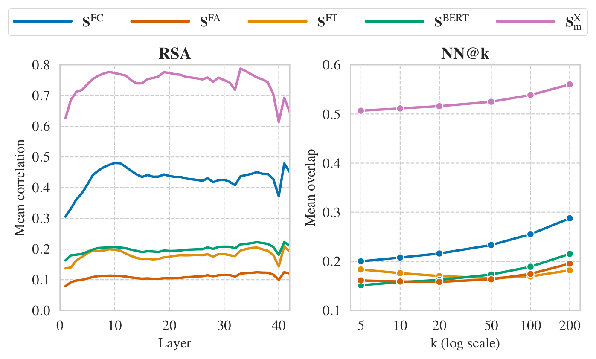
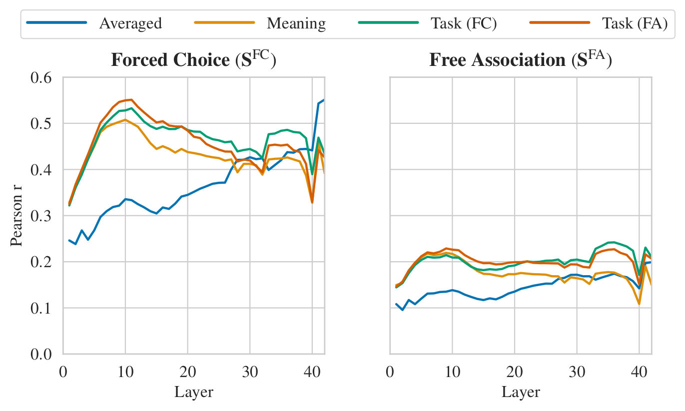
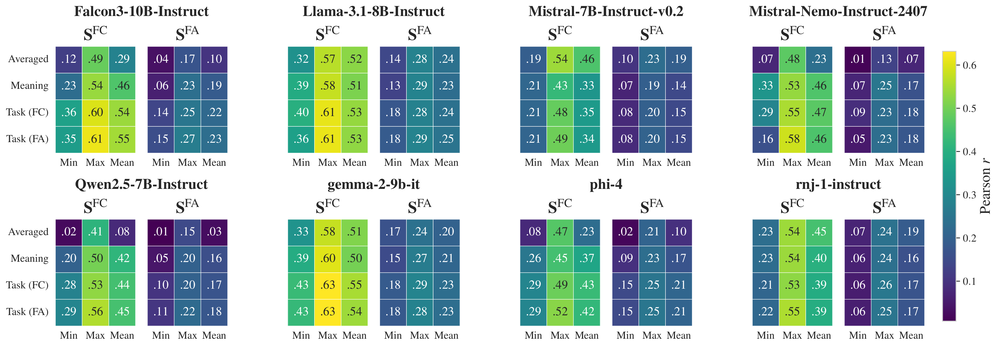
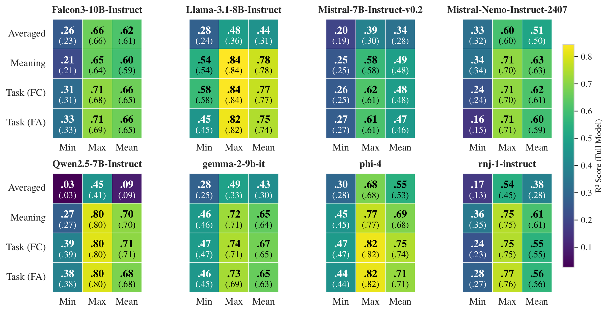

## Motivation

In cognitive science, semantic knowledge is treated as a latent structure: we cannot observe a speaker's meaning representation directly, but we can systematically probe it through behavior. Word-association paradigms use exactly this logic, when a participant sees a cue (e.g., _dog_), the associations they produce or select (e.g., _cat_, _leash_, _bark_) are constrained by their underlying semantic organization. When such judgments are aggregated across trials, the resulting response statistics yield a similarity matrix that approximates the geometry of an otherwise unobserved semantic system.

We transfer this measurement logic to large language models. Unlike humans, both behavior _and_ internal representations are observable in LLMs. This creates a unique opportunity: we can systematically test how well an LLM's behavioral output reveals its internal semantic geometry. A key open question is not only how model behavior compares to humans, but also what a model's _own_ behavior reveals about its _own_ internal representations.

<div class="figure-container">
  <iframe class="anim-figure" src="/assets/html/blog/neural_semantic_geometry/conceptual_rsa_loop.html" style="--ar: 864 / 1170; --max-w: 620px" loading="lazy" title="Animated conceptual overview of the framework"></iframe>
  <span class="figure-caption"><b>Figure 1.</b> Each word yields a hidden-state geometry (A) and a behavioral geometry (B); RSA correlates the two.</span>
</div>

## Framework

### Two behavioral paradigms

We use two classic psycholinguistic paradigms, forced choice (FC) and free association (FA), to collect semantic relations from model behavior over a shared vocabulary of 5,000 high-frequency English nouns.

<div class="project-grid cols-2">
  <div class="project-card">
    <h4 class="highlight-text">Forced choice (FC)</h4>
   <p>Each cue word appears with 16 candidates; the model picks the two most semantically related to the cue.</p>  </div>
  <div class="project-card">
    <h4 class="highlight-text">Free association (FA)</h4>
    <p>The model is prompted with a single cue word and asked to generate exactly five single-word associates.</p>
  </div>
</div>

<div class="anim-compare" id="paradigm-compare" data-view="both" data-sync="paradigms">
  <div class="seg-toggle" role="group" aria-label="Show the paradigm animations" data-target="#paradigm-compare">
    <span class="seg-toggle__thumb" aria-hidden="true"></span>
    <button type="button" class="seg-toggle__opt is-active" data-value="both" aria-pressed="true">Both</button>
    <button type="button" class="seg-toggle__opt" data-value="fc" aria-pressed="false">Forced choice</button>
    <button type="button" class="seg-toggle__opt" data-value="fa" aria-pressed="false">Free association</button>
  </div>
  <div class="anim-compare__panels">
    <div class="figure-container anim-compare__panel" data-panel="fc">
      <iframe class="anim-figure" src="/assets/html/blog/neural_semantic_geometry/forced_choice_intro_loop.html?sync=paradigms" style="--ar: 640 / 1329; --max-w: 440px" loading="lazy" title="Animated forced choice paradigm"></iframe>
    </div>
    <div class="figure-container anim-compare__panel" data-panel="fa">
      <iframe class="anim-figure" src="/assets/html/blog/neural_semantic_geometry/free_association_intro_loop.html?sync=paradigms" style="--ar: 640 / 1329; --max-w: 440px" loading="lazy" title="Animated free association paradigm"></iframe>
    </div>
  </div>
  <span class="figure-caption"><b>Figure 2.</b> Forced choice and free association: responses fill <b>B</b>; cosine similarity between its rows gives <b>S</b>.</span>
</div>

For each paradigm, model outputs are aggregated into a sparse cue–response count matrix **B**. We reweight counts with positive pointwise mutual information (PPMI) to reduce the influence of globally frequent responses, then compute a cue–cue similarity matrix via cosine similarity between the PPMI-weighted row vectors. In total, we collected over **17.5 million trials** across both paradigms and eight models.

### Hidden-state extraction

For each model and each word, we extract layerwise hidden-state representations under four contextual embedding strategies:

<div class="project-grid cols-2">
  <div class="project-card">
    <h4 class="highlight-text">Averaged</h4>
<p>Target word in 50 C4 sentences, hidden states averaged across contexts.</p>  </div>
  <div class="project-card">
    <h4 class="highlight-text">Meaning</h4>
    <p>A fixed definition-style prompt (<em>"What is the meaning of the word {w}?"</em>).</p>
  </div>
  <div class="project-card">
    <h4 class="highlight-text">Task (FC)</h4>
    <p>The target word embedded in the FC instruction prompt (without candidates).</p>
  </div>
  <div class="project-card">
    <h4 class="highlight-text">Task (FA)</h4>
    <p>The target word embedded in the FA instruction prompt.</p>
  </div>
</div>

Hidden-state similarity matrices are computed as cosine similarity between mean-centered layerwise word vectors.

<div class="figure-container">
  <iframe class="anim-figure" src="/assets/html/blog/neural_semantic_geometry/hidden_states_intro_loop.html" style="--ar: 2040 / 1275" loading="lazy" title="Animated hidden-state extraction"></iframe>
  <span class="figure-caption"><b>Figure 3.</b> Hidden-state extraction: the cue word's state at layer <em>ℓ</em> fills a row of <b>H</b><sup><em>ℓ</em></sup>, giving <b>S</b><sup>hid</sup>.</span>
</div>

### Models and baselines

We evaluate eight instruction-tuned decoder-only transformer models ranging from 7B to 14B parameters (Falcon3, Gemma-2, Llama-3.1, Mistral-7B, Mistral-Nemo, Phi-4, Qwen2.5, and rnj-1). Beyond behavioral embeddings, we compare hidden-state similarities to three baselines: **FastText** (static word vectors), **BERT** (contextual encoder), and a **cross-model consensus** geometry aggregating hidden-state similarities across all other models, motivated by recent evidence for a shared semantic subspace across diverse LLMs.

<div class="figure-container">
  <iframe class="anim-figure" src="/assets/html/blog/neural_semantic_geometry/cross_model_consensus_loop.html" style="--ar: 1600 / 940" loading="lazy" title="Animated cross-model consensus baseline"></iframe>
  <span class="figure-caption"><b>Figure 4.</b> Cross-model consensus: the other models' similarity matrices, averaged (toy data).</span>
</div>

### Evaluation

We use three complementary evaluation methods:

<div class="project-grid cols-1">
  <div class="project-card">
    <h4 class="highlight-text">Representational Similarity Analysis (RSA)</h4>
    <p>For each layer, we vectorize the upper-triangular entries of the hidden-state and reference similarity matrices and compute their Pearson correlation.</p>
  </div>
  <div class="project-card">
    <h4 class="highlight-text">Nearest-neighbor overlap (NN@k)</h4>
    <p>We quantify how well the *k*-nearest-neighbor neighborhoods induced by hidden-state similarity match those of the reference spaces.</p>
  </div>
  <div class="project-card">
    <h4 class="highlight-text">Held-out-words ridge regression</h4>
    <p>We test whether behavioral similarity predicts unseen hidden-state similarities on held-out words beyond lexical baselines and cross-model consensus.</p>
  </div>
</div>

## Results

### Forced choice aligns substantially more than free association

Across all models and evaluation methods, FC behavior aligns substantially more strongly with hidden-state geometry than FA. Mean FC RSA increases from _r_ = .346 under Averaged extraction to _r_ = .463 under Task (FC), while FA shows the same pattern at considerably lower magnitude (_r_ = .140 to _r_ = .199).

<div class="figure-container">
  
  <span class="figure-caption"><b>Figure 5.</b> Mean RSA by layer (left) and neighbor overlap by <em>k</em> (right): FC (green) beats FA (red); consensus (black) is highest.</span>
</div>

Task-aligned and meaning-based extraction strategies yield the strongest alignment at earlier, mid-depth layers, whereas averaging over natural contexts shifts alignment peaks to later layers.

<div class="figure-container">
  
  <span class="figure-caption"><b>Figure 6.</b> Layerwise RSA for FC (left) and FA (right) by extraction strategy.</span>
</div>

The full model-by-model RSA comparison reveals that the FC advantage is consistent across all eight models, though the magnitude varies:

<div class="figure-container">
  
  <span class="figure-caption"><b>Figure 7.</b> RSA per model for FC and FA across strategies and layers.</span>
</div>

### Behavioral similarity predicts unseen hidden-state structure

The held-out-words ridge regression shows that behavioral similarity, especially FC, predicts unseen hidden-state similarities beyond lexical baselines and cross-model consensus. Adding behavioral FC similarity on top of the baseline improves mean test *R*² by +.022, whereas FA yields a smaller gain (+.002). The full model reaches mean *R*² = .587 (vs. .569 for the baseline). Peak performance reaches *R*² = .844 for Llama-3.1-8B-Instruct.

<div class="figure-container">
  
  <span class="figure-caption"><b>Figure 8.</b> Ridge regression <em>R</em>² per model: full model (bold) vs. baselines only (in parentheses).</span>
</div>

## Discussion

Our findings show that structured behavior, particularly from constrained measurement paradigms like forced choice, preserves a nontrivial projection of a model's hidden-state similarity geometry, even without access to logits or internal activations. This has implications for both interpretability research and cognitive science:

<div class="project-grid cols-1">
  <div class="project-card">
    <h4 class="highlight-text">For interpretability</h4>
    <p>Behavioral probing can serve as a practical tool for understanding internal representations when only black-box access is available. The FC paradigm's controlled candidate sets concentrate observations and produce a less sparse cue–response matrix, yielding higher signal-to-noise measurements of semantic geometry.</p>
  </div>
  <div class="project-card">
    <h4 class="highlight-text">For cognitive science</h4>
    <p>Using our fully observable language-model setup, we can subject a core assumption to rigorous empirical tests: that structured behavior is constrained by, and can therefore partially reveal, internal states. The finding that measurement protocol strongly determines recoverability (FC vs. FA) suggests that whether a behavioral task <em>reveals</em> internal structure is not a generic property of "behavior": it depends critically on how responses are constrained and aggregated.</p>
  </div>
  <div class="project-card">
    <h4 class="highlight-text">Cross-model consensus</h4>
    <p>Similarity structure shared across other LLMs explains a large fraction of variance in a target model's hidden-state geometry, consistent with the hypothesis of a common semantic subspace.</p>
  </div>
</div>

## Citation

If you find this work helpful for your research, please consider citing our paper:

```bibtex
@inproceedings{schiekiera2026associations,
  title     = {From Associations to Activations: Comparing Behavioral and
               Hidden-State Semantic Geometry in {LLM}s},
  author    = {Schiekiera, Louis and Zimmer, Max and Roux, Christophe
               and Pokutta, Sebastian and G{\"u}nther, Fritz},
  booktitle = {Proceedings of the 43rd International Conference on
               Machine Learning},
  series    = {Proceedings of Machine Learning Research},
  volume    = {306},
  pages     = {108177--108203},
  publisher = {PMLR},
  year      = {2026},
  url       = {https://proceedings.mlr.press/v306/schiekiera26a.html}
}
```
